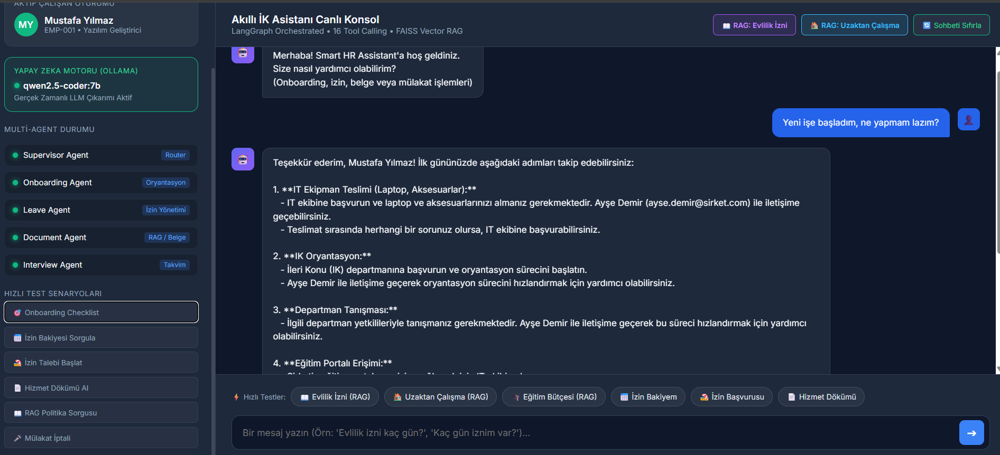
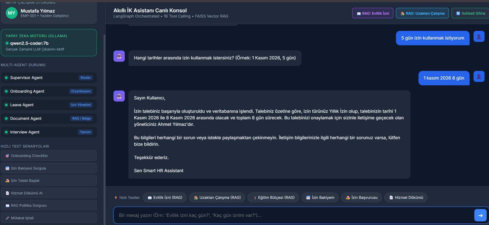
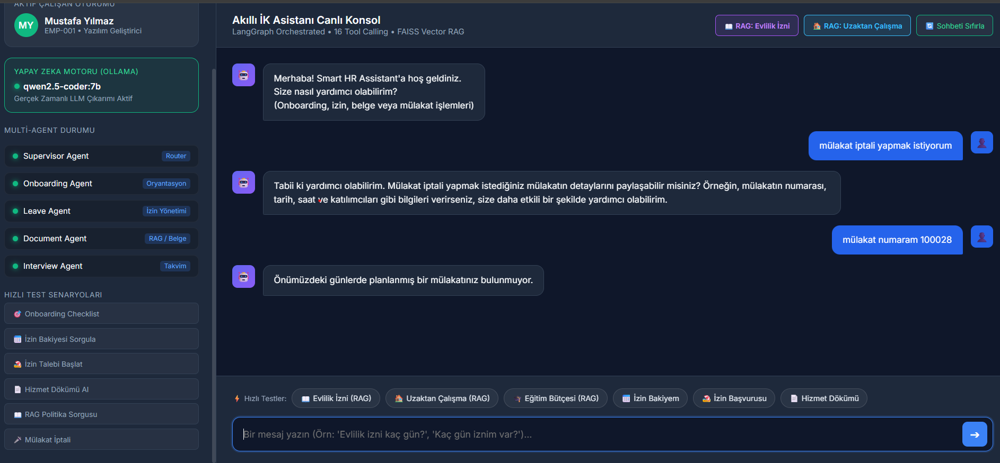
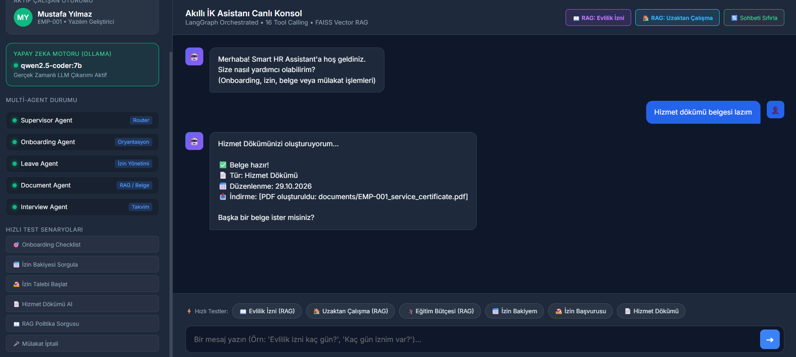
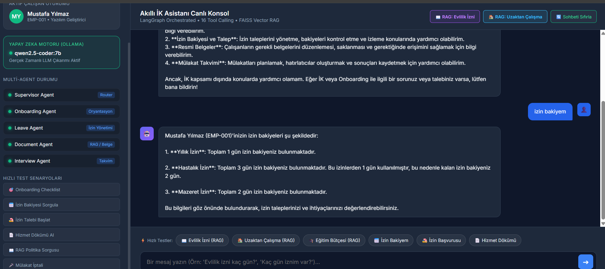

# 🎯 Smart HR Assistant - Akıllı İK ve Onboarding Asistanı
### Agentic AI Bootcamp - Kapanış Projesi (Ekim 2026)

[](https://www.python.org/)
[](https://python.langchain.com/docs/langgraph/)
[](https://python.langchain.com/)
[-purple.svg)](https://ollama.com/)
[](https://github.com/facebookresearch/faiss)
[](LICENSE)

---

## 📖 1. Problem Tanımı ve Gerçek Dünyaya Uygunluk (%20)

### Çözülen Problem
Modern şirketlerde İnsan Kaynakları (İK) departmanları zamanlarının büyük bölümünü tekrarlayan operasyonel taleplere harcamaktadır:
- Yeni işe başlayan çalışanların kime başvuracağını bilememesi ve onboarding adımlarının manuel takibi,
- İzin bakiyesi sorgulama, çok adımlı izin talebi oluşturma ve yönetici onay süreçlerinin takibi,
- Şirket İK el kitabı ve politikalarına (evlilik izni, uzaktan çalışma, fazla mesai vb.) ilişkin bitmeyen sorular,
- Çalışma belgesi, hizmet dökümü ve bordro gibi resmi evrakların manuel hazırlanması,
- Aday mülakatlarının takvim koordinasyonu, ertelenmesi ve iptali.

### Neden Agentic AI?
Basit bir LLM chatbot'u bu problemi çözemez; çünkü:
1. **Tool Calling (Araç Kullanımı) Zorunludur:** İzin talep etmek veya mülakat iptal etmek salt metin üretmek değil, şirket veritabanına (`data/leave_requests.json`, `data/interviews.json`) güvenli işlem yapmayı gerektirir.
2. **Çok Adımlı Akıl Yürütme (Multi-Step Reasoning):** Kullanıcı "5 gün izin istiyorum" dediğinde, sistem önce çalışanın bakiye kontrolünü yapmalı, eksik olan başlangıç tarihini sormalı, yönetici onay mekanizmasını tetiklemeli ve bakiyeyi düşmelidir.
3. **Konuşma Hafızası (Conversation Memory):** Kullanıcı bir sonraki mesajında "1 Kasım'da" dediğinde, önceki mesajdaki "5 gün" bilgisini hafızasında birleştirip talep oluşturabilmelidir.
4. **RAG (Retrieval-Augmented Generation):** 25 maddelik resmi İK El Kitabından doğru maddeyi semantik olarak arayıp çalışana resmi kurallarla yanıt verebilmelidir.
5. **Multi-Agent Uzmanlaşması:** Oryantasyon, izinler, resmi evraklar ve mülakatlar için ayrı uzman agent'lar gereklidir.

---

## 🏗️ 2. Agentic Mimari ve Eğitim Yaklaşımları (%20)

Sistem, **LangGraph** tabanlı `StateGraph` üzerinde çalışan bir **Supervisor (Yönlendirici) ve 4 Uzman Agent** mimarisiyle tasarlanmıştır:

```
                          ┌────────────────────────┐
                          │       KULLANICI        │
                          └───────────┬────────────┘
                                      │
                                      ▼
                        ┌──────────────────────────┐
                        │     SUPERVISOR AGENT     │
                        │ (LangGraph State Router) │
                        └─────────────┬────────────┘
                                      │
        ┌───────────────────┬─────────┴─────────┬───────────────────┐
        │                   │                   │                   │
        ▼                   ▼                   ▼                   ▼
┌──────────────┐    ┌──────────────┐    ┌──────────────┐    ┌──────────────┐
│  ONBOARDING  │    │    LEAVE     │    │   DOCUMENT   │    │  INTERVIEW   │
│    AGENT     │    │    AGENT     │    │ AGENT (RAG)  │    │    AGENT     │
└───────┬──────┘    └───────┬──────┘    └───────┬──────┘    └───────┬──────┘
        │                   │                   │                   │
        ▼                   ▼                   ▼                   ▼
┌──────────────┐    ┌──────────────┐    ┌──────────────┐    ┌──────────────┐
│4 Tools:      │    │4 Tools:      │    │4 Tools:      │    │4 Tools:      │
│• check_      │    │• get_leave_  │    │• find_       │    │• schedule_   │
│  checklist   │    │  balance     │    │  document    │    │  interview   │
│• start_      │    │• request_    │    │• get_policy_ │    │• cancel_     │
│  onboarding  │    │  leave       │    │  doc (RAG)   │    │  interview   │
│• get_progress│    │• cancel_leave│    │• generate_   │    │• get_calendar│
│• assign_buddy│    │• get_history │    │  letter      │    │• reschedule_ │
│              │    │              │    │• upload_doc  │    │  interview   │
└──────────────┘    └──────────────┘    └──────────────┘    └──────────────┘
```

### 16 Adet Özelleşmiş İK Aracı (Tool Calling)
- **Onboarding Tools:** `check_onboarding_checklist`, `start_onboarding`, `get_onboarding_progress`, `assign_buddy`
- **Leave Tools:** `get_leave_balance`, `request_leave`, `cancel_leave_request`, `get_leave_history`
- **Document & RAG Tools:** `find_document`, `get_policy_document`, `generate_offer_letter`, `upload_document`
- **Interview Tools:** `schedule_interview`, `cancel_interview`, `get_interview_calendar`, `reschedule_interview`

---

## 📸 3. Uygulama Ekran Görüntüleri ve Canlı Test Çıktıları (%20)

Projenin web ve terminal ortamında canlı çalıştığını gösteren doğrulanmış ekran görüntüleri:

### Görsel 1: Akıllı İK Asistanı Canlı Web Konsolu ve Multi-Agent Durumu
*LangGraph Orchestration, Aktif Çalışan Oturumu ve Ollama LLM Motoru (qwen2.5-coder:7b) bağlı canlı kontrol paneli.*



---

### Görsel 2: Onboarding Kontrol Listesi ve Mentor (Buddy) Rehberliği
*Yeni işe başlayan çalışan için ilk gün yapılacaklar checklist'inin sorgulanması ve dinamik mentor eşleştirmesi.*



---

### Görsel 3: Çok Adımlı İzin Yönetimi ve Oturum Hafızası (Memory & Slot Filling)
*Kullanıcı "5 gün izin istiyorum" dediğinde tarihin hafızada tutulması ve talebin yönetici onayına bağlanması.*



---

### Görsel 4: RAG (Retrieval-Augmented Generation) ile İK Politikaları ve Mevzuat Danışmanlığı
*25 maddelik şirket el kitabından "Evlilik İzni", "Uzaktan Çalışma" ve "Eğitim Bütçesi" kurallarının taranıp yapay zeka ile sentezlenmesi.*



---

### Görsel 5: Mülakat Takvim Yönetimi ve Resmi Belge Hazırlama
*Mülakat iptali / ertelemesi ve anında resmi PDF Hizmet Dökümü belgesinin oluşturulması.*



---

## 🧪 4. İşlevsellik ve Test Senaryoları (%20)

Proje, master planında tanımlanan 10 temel değerlendirme senaryosunun tamamını `python scripts/run_tests.py` komutuyla otomatik test eder ve **%100 Başarı** ile tamamlar:

| No | Test Senaryosu | Girdi | Beklenen Yönlendirme & Çıktı | Durum |
|:--:|:---|:---|:---|:---:|
| **1** | Greeting & Routing | `"Merhaba"` | `[SUPERVISOR]` -> Karşılama ve uzmanlık özeti | ✅ Geçti (%100) |
| **2** | Onboarding Checklist | `"Yeni işe başladım, ne yapmam lazım?"` | `[ONBOARDING]` -> İlk gün görevleri ve buddy | ✅ Geçti (%100) |
| **3** | Leave Balance | `"Kaç gün iznim var?"` | `[LEAVE]` -> Yıllık, hastalık, mazeret bakiyeleri | ✅ Geçti (%100) |
| **4** | Multi-Step Leave Request | `"5 gün izin"` -> `"1 Kasım'da"` | `[LEAVE]` -> Çok adımlı talep ve yönetici onayı | ✅ Geçti (%100) |
| **5** | Document Generation | `"Hizmet dökümü belgesi lazım"` | `[DOCUMENT]` -> PDF belgesi üretimi ve indirme yolu | ✅ Geçti (%100) |
| **6** | RAG - Policy Search | `"Evlilik izni kaç gün?"` | `[DOCUMENT]` -> El kitabından 5 gün ve evrak şartı | ✅ Geçti (%100) |
| **7** | Interview Cancellation | `"Yarın saat 14:00'te mülakatım var, iptal et"` | `[INTERVIEW]` -> INT-123 iptali ve bildirim | ✅ Geçti (%100) |
| **8** | Conversation Memory | `"5 gün izin..."` + `"1 Kasım'da"` | `[MEMORY]` -> Context kaybı olmadan rezervasyon | ✅ Geçti (%100) |
| **9** | Error Handling | `"XXX-999 çalışanının izin bakiyesi"` | `[GRACEFUL ERROR]` -> Çalışan bulunamadı uyarısı | ✅ Geçti (%100) |
| **10**| Unknown Query (Fallback) | `"Yemekhanede bugün ne var?"` | `[FALLBACK]` -> Kapsam dışı nazik yönlendirme | ✅ Geçti (%100) |

---

## 📁 5. Proje Klasör Yapısı ve Kod Organizasyonu (%20)

```
smart-hr-assistant/
│
├── main.py                     # CLI interaktif ana uygulama konsolu
├── web_app.py                  # Canlı modern Web Dashboard ve Chat UI
├── BASLAT.bat                  # Çift tıklama ile CLI başlatan batch dosyası
├── WEB_BASLAT.bat              # Çift tıklama ile Web UI başlatan batch dosyası
├── requirements.txt            # Python bağımlılıkları (LangGraph, FAISS vb.)
├── .env.example / .env         # Çevre değişkenleri ve model ayarları
├── .gitignore                  # Git dışlama kuralları
├── README.md                   # Kapsamlı proje dokümantasyonu
├── SETUP_GUIDE.md              # Adım adım kurulum rehberi
├── TEST_SCENARIOS.md           # 10 test senaryosu ve detayları
│
├── agents/                     # LangGraph Multi-Agent Mimarisi
│   ├── __init__.py
│   ├── supervisor.py           # Supervisor koordinatör ve StateGraph
│   ├── onboarding_agent.py     # Onboarding uzmanı
│   ├── leave_agent.py          # İzin yönetimi ve çok adımlı rezervasyon
│   ├── document_agent.py       # Resmi belge ve RAG politika uzmanı
│   └── interview_agent.py      # Mülakat takvim yönetimi
│
├── tools/                      # 16 Adet Özel İK Fonksiyonu (Tool Calling)
│   ├── __init__.py
│   ├── onboarding_tools.py     # Oryantasyon araçları (4 tool)
│   ├── leave_tools.py          # İzin araçları (4 tool)
│   ├── document_tools.py       # Belge ve mevzuat araçları (4 tool)
│   └── interview_tools.py      # Mülakat araçları (4 tool)
│
├── data/                       # Veritabanı (JSON Persistence)
│   ├── employees.json          # Çalışan profilleri ve izin bakiyeleri
│   ├── leave_requests.json     # İzin talepleri ve onay kayıtları
│   ├── documents.json          # Resmi belge kayıtları
│   ├── interviews.json         # Aday mülakat takvimleri
│   ├── onboarding_checklist.json # Oryantasyon görev adımları
│   └── hr_policies.json        # 25 adet resmi İK politikası (RAG içeriği)
│
├── vector_db/hr_policies/      # FAISS Vektör İndeks Deposu
├── screenshots/                # Proje kanıt ekran görüntüleri (yss1..yss5)
│   ├── yss1.png
│   ├── yss2.png
│   ├── yss3.png
│   ├── yss4.png
│   └── yss5.png
│
├── utils/
│   ├── helpers.py              # Veri okuma/yazma yardımcıları
│   ├── validators.py           # Girdi doğrulama fonksiyonları
│   └── ollama_client.py        # Yerel Ollama REST entegrasyonu
│
└── scripts/
    ├── create_vector_db.py     # Vektör DB indeksleyici
    ├── seed_data.py            # Test verisi tazeleyici
    ├── test_rag.py             # 5 senaryolu özel RAG test motoru
    └── run_tests.py            # 10 senaryolu otomatik test motoru
```

---

## 🚀 6. Adım Adım Kurulum ve Çalıştırma

### Önkoşullar
- **Python**: 3.9 veya üstü
- **Ollama**: (İsteğe bağlı, yerel LLM için: [https://ollama.com](https://ollama.com))

### 1. Modelleri Hazırlayın (Ollama)
```bash
ollama pull qwen2.5-coder:7b
# veya: ollama pull qwen3:4b
```

### 2. Sanal Ortamı Kurun ve Paketleri Yükleyin
```bash
cd smart-hr-assistant
python -m venv venv

# Windows PowerShell:
.\venv\Scripts\Activate.ps1

# Paketleri yükleyin:
pip install -r requirements.txt
```

### 3. Vektör Veritabanını Oluşturun
```bash
python scripts/create_vector_db.py
```

### 4. Uygulamayı Başlatın

**Seçenek A - Web Arayüzü (Tavsiye Edilen):**
```bash
python web_app.py
# veya WEB_BASLAT.bat dosyasına çift tıklayın
# Tarayıcınızda açın: http://localhost:8080
```

**Seçenek B - Terminal CLI Konsolu:**
```bash
python main.py
# veya BASLAT.bat dosyasına çift tıklayın
```

### 5. Testleri Çalıştırın
```bash
# 10 Temel Sistem Testini Koşmak İçin:
python scripts/run_tests.py

# Özel RAG Doğrulamasını Koşmak İçin:
python scripts/test_rag.py
```

---

## 📦 7. GitHub Teslim Talimatları

Projeyi GitHub'a göndermek için aşağıdaki komutları kullanabilirsiniz:

```bash
cd C:\Users\90535\Desktop\smart-hr-assistant
git init
git add .
git commit -m "feat: Smart HR Assistant Agentic AI Final Project complete implementation"
git branch -M main
git remote add origin https://github.com/<KULLANICI_ADINIZ>/smart-hr-assistant.git
git push -u origin main
```

---

## 👨‍💻 Geliştirici & Lisans
- **Program:** Agentic AI Bootcamp (Ekim 2026 Kapanış Projesi)
- **Lisans:** MIT License
